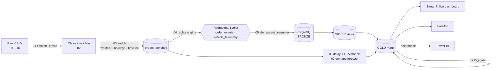

# 🚚 FleetPulse — Real-Time Logistics Intelligence Platform

> End-to-end data solution for a Texas regional logistics operator: **streaming ingestion → medallion warehouse → data-quality gate → analytics → ML & forecasting → live dashboard.**
>
> 100% free / open-source stack · reproducible with one `docker compose up` · every step documented and tested.

**Built by [Seam Analytics](https://github.com/) · MIT License**

---

## ⚠️ Read this first: what "real-time" means here

The supplied dataset is **historical** (orders from 2023-01-01 to 2024-12-31). FleetPulse therefore runs as a **replay-simulated real-time system**: history is turned into a time-ordered *event stream* and published into Kafka-compatible topics at an adjustable speed. Everything downstream (consumer, idempotent writes, late/duplicate handling, latency monitoring, live dashboard) behaves exactly as it would on a live source. Swapping the simulator for a real producer changes **one component**.

Every column is labelled **SOURCE / EXTERNAL / DERIVED / SYNTHETIC** in [`docs/02_DATA_DICTIONARY.md`](docs/02_DATA_DICTIONARY.md). Nothing synthetic is hidden, and no fake signal is injected to make models look better.

### Important execution note

The current streaming producer replays historical events. The dashboards provide a live-updating view of the replay and processing state, not a connection to an actual logistics operator's live order-management or vehicle-tracking system.

Synthetic vehicle telemetry is explicitly labelled in the dashboard. Historical replay and bulk backfill measurements should not be interpreted as representative production streaming benchmarks.

## Architecture



## Quick start (≈10 minutes)

```bash
git clone <your-repo> && cd fleetpulse
python -m venv .venv && source .venv/bin/activate        # Windows Git Bash: source .venv/Scripts/activate
pip install -r requirements.txt
cp .env.example .env
docker compose up -d                                      # Postgres + Redpanda + Redpanda Console (http://localhost:8080)

make offline        # steps 01-03  (needs internet once, for real weather from Open-Meteo)
make backfill       # steps 04-05  history -> Kafka -> bronze
make warehouse      # step 06
make dq             # step 07      must end with "0 blocking failures"
make ml forecast    # steps 08-09
# --- go live (two terminals) ---
make consume        # terminal A
make live           # terminal B  (1 simulated hour per real second)
make dashboard      # terminal C  -> http://localhost:8501
```

No `make`? Every command is a plain `python pipeline/NN_*.py` call, see [`docs/05_RUNBOOK.md`](docs/05_RUNBOOK.md).

No Docker? Use `--sink jsonl` / `--source jsonl` and a local PostgreSQL (the CI does exactly this).

## Original and Demo environments

FleetPulse supports two separately configured execution environments: **Original** and **Demo**.

The purpose of this separation is to allow a demonstration or replay run without using the Original database or publishing Demo events into the Original Kafka topics.

| Component | Original | Demo |
|---|---|---|
| Configuration | `configs/settings.yaml` | `configs/settings.demo.yaml` |
| PostgreSQL database | `fleetpulse` | `fleetpulse_demo` |
| Kafka order topic | `fleetpulse.order_events` | `fleetpulse_demo.order_events` |
| Kafka telemetry topic | `fleetpulse.vehicle_telemetry` | `fleetpulse_demo.vehicle_telemetry` |
| Dashboard entry point | `services/dashboard/app.py` | `services/dashboard/app_demo.py` |
| Dashboard port | `8501` | `8502` |
| Model/report output | Original configured directories | Demo-specific configured directories |
| Stream output | Original configured directory | `data/stream_demo` |
| Forecast output | Original configured directory | `data/forecast_demo` |

### How environment selection works

The shared configuration loader in `src/fleetpulse/common.py` selects the configuration using the `FLEETPULSE_CONFIG` environment variable.

The Demo launcher, `scripts/demo_env.py`, starts a pipeline command with:

- `FLEETPULSE_CONFIG=settings.demo.yaml`
- `PG_DB=fleetpulse_demo`

This ensures that the launched Demo process uses the Demo configuration and database from the beginning of execution.

Example:

```bash
python scripts/demo_env.py pipeline/04_replay_stream.py --mode backfill --sink kafka
```

The wrapper can also be used for other pipeline scripts:

```bash
python scripts/demo_env.py pipeline/05_consume_to_postgres.py --group fleetpulse-demo-bronze-writer

python scripts/demo_env.py pipeline/06_build_warehouse.py
```

Original commands are executed directly, without the Demo wrapper.

**Isolation boundary:** Original and Demo use separate PostgreSQL databases, Kafka topic names, and configured runtime output locations. They share the same Redpanda broker and some historical source-data directories, including the configured raw, interim, and processed datasets. This is logical environment separation, not separate physical infrastructure.

## Windows / Git Bash execution

The development environment used for validation is Windows with Git Bash and an active Python virtual environment.

If `make` is unavailable, the pipeline scripts can be executed directly with Python. For Demo execution, use `scripts/demo_env.py` so the correct configuration and database are selected.

### Start the services

```bash
docker compose up -d
```

The local services expose:

| Service | Local address |
|---|---|
| PostgreSQL | `localhost:5433` |
| Redpanda Kafka-compatible broker | `localhost:19092` |
| Redpanda Console | `http://localhost:8080` |
| Original Streamlit dashboard | `http://localhost:8501` |
| Demo Streamlit dashboard | `http://localhost:8502` |

### Run the dashboards

Original:

```bash
streamlit run services/dashboard/app.py --server.port 8501
```

Demo:

```bash
streamlit run services/dashboard/app_demo.py --server.port 8502
```

Run each dashboard as a separate process. The Original dashboard connects to the Original environment; the Demo dashboard uses the Demo environment.

## Streaming ingestion and processing

FleetPulse separates event production from database ingestion.

### 1. Historical event replay

`pipeline/04_replay_stream.py` reads the processed historical dataset and publishes order events and vehicle telemetry.

Supported modes:

- `backfill`: replays the historical event set.
- `live`: replays events according to the configured simulated-time speed.
- `--sink kafka`: publishes events to the configured Kafka-compatible topics.
- `--sink jsonl`: writes events to JSONL for local or alternative execution.

Example:

```bash
python scripts/demo_env.py pipeline/04_replay_stream.py --mode backfill --sink kafka
```

### 2. Kafka consumer and Bronze ingestion

`pipeline/05_consume_to_postgres.py` consumes events from Kafka and writes them to PostgreSQL Bronze tables.

Key processing characteristics:

- Configurable consumer group, batch size, and flush interval.
- Kafka auto-commit disabled.
- Database transaction completed before Kafka offsets are committed.
- Duplicate event handling through deterministic event identity and `ON CONFLICT DO NOTHING`.
- Failed or invalid records can be routed to the dead-letter table.
- Consumer lag can be inspected through Kafka consumer-group monitoring.

The Demo consumer uses a separate consumer group:

```bash
python scripts/demo_env.py pipeline/05_consume_to_postgres.py --group fleetpulse-demo-bronze-writer
```

### 3. Warehouse construction

The warehouse build step creates or refreshes the downstream analytical layers:

- **Bronze:** ingested source events and ingestion metadata.
- **Silver:** cleaned, consolidated, and business-oriented data views.
- **Gold:** analytical fact tables, dimensions, KPIs, and dashboard-ready views.

Example:

```bash
python scripts/demo_env.py pipeline/06_build_warehouse.py
```

The warehouse is built from PostgreSQL data. The dashboard reads from the Gold layer rather than directly from the raw event stream.

## Verified Demo execution snapshot

The following values describe a completed Demo backfill and warehouse validation on **12 November 2026**. They are execution evidence, not permanent dataset guarantees or production SLAs.

| Validation | Observed result |
|---|---:|
| Source events processed by replay | 139,391 |
| Events published to Kafka | 139,324 |
| Replay errors | 0 |
| Late events reported by replay | 1,478 |
| Duplicate deliveries reported by replay | 708 |
| Demo Bronze order events after ingestion | 139,391 |
| Demo Bronze vehicle telemetry records | 14,432 |
| Demo dead-letter records | 0 |
| Demo consumer-group lag after catch-up | 0 |
| Demo warehouse build | Successful |

The replay reported 67 fewer published events than source events. This is consistent with the replay's duplicate-delivery behaviour; published-message counts and final Bronze row counts represent different stages of processing.

The completed Demo warehouse included the Silver and Gold analytical views used by the dashboard.

### Pipeline Health and latency observations

Both environments maintain their own `gold.pipeline_health` history.

A validation query can compare the two databases:

```sql
SELECT
    minute,
    events_ingested,
    ROUND(avg_latency_seconds::numeric, 3) AS latency_seconds
FROM gold.pipeline_health
ORDER BY minute ASC;
```

Run this query separately against `fleetpulse` and `fleetpulse_demo`.

Observed snapshot:

| Metric | Original | Demo |
|---|---:|---:|
| Pipeline health points | 5 | 8 |
| Total recorded events | 139,391 | 139,391 |
| Latest recorded point (UTC) | 2026-11-12 12:24 | 2026-11-12 16:58 |

The two environments have separate monitoring histories. Their total recorded event counts happen to match, but their processing timestamps and latency measurements differ.

**Latency interpretation:** bulk backfill and small streaming batches are not directly comparable. For example, the Original history contained a 138,616-event batch with a recorded average latency of 211.037 seconds, while the Demo history contained a 138,611-event batch with a recorded average latency of 1.693 seconds. These are observations from separate runs under potentially different execution conditions, not a controlled performance benchmark.

## What the data says (reference run)

| Finding | Evidence |
|---|---|
| On-time delivery is **79.6 %** (27,727 delivered orders), flat across 2023–2024 | `gold.kpi_daily_hub` |
| A delayed order costs **1.5 CSAT points** (3.02 vs 4.50) and takes 23 h longer | `gold.fct_orders` |
| **Dallas Main Hub averages ~122 % of capacity** (114–135 % in every quarter); the other five hubs average 75–78 % | `gold.kpi_hub_utilization_monthly` (capacity unit inferred, ADR-0003) |
| Delays are **statistically uniform** across hubs, vehicles, drivers, service level, weather and calendar | chi-square tests, `reports/ml/segments.csv` |
| Predicting delays is **not possible with the available data** (ROC-AUC ≈ 0.50) — reported honestly, model flagged *NOT RELIABLE* | `reports/ml/model_card.md` |
| Demand can be forecast 14 days ahead better than the baselines (WAPE 0.314 vs 0.336 seasonal-naive) — a modest gain, noise-limited at 6-10 orders/hub/day | `reports/ml/forecast_backtest.json` |

## Quality & engineering standards

- **Idempotent streaming:** deterministic event IDs + `ON CONFLICT DO NOTHING`; replaying a file twice inserts 0 rows (tested).
- **Chaos built in:** ~0.5 % duplicate and ~1 % late/out-of-order events are injected on purpose.
- **Data-quality gate:** 13 executable SQL assertions (step 07) + 24-rule source audit (step 02).
- **Reconciliation:** warehouse totals equal the source file exactly (delivered, delayed, on-time, CSAT, durations).
- **Honest ML:** time-ordered split, bootstrap CIs, pre-registered verdict rule, leakage controls, model card.
- **22 automated tests**, GitHub Actions CI (lint → pipeline → DQ gate → ML → tests).

## Repository map

```text
configs/settings.yaml      central configuration            pipeline/01…09_*.py   numbered pipeline steps
sql/00…04_*.sql            bronze · dims · silver · gold     src/fleetpulse/       shared library (events, features, ml, weather)
services/api               FastAPI (predict, forecast)       services/dashboard    Streamlit live dashboard
tests/                     unit · contract · integration     docs/                 architecture, dictionary, ADRs, per-step docs
reports/                   generated DQ + ML reports         executive_summary.md  client-facing  |  conclusion_summary.md  technical
```

## Roadmap

- [x] Phase 1 — Data engineering, warehouse, streaming, DQ, ML, forecast, live dashboard, API
- [ ] **Phase 2 — Power BI analytical dashboards** (connection + page plan ready: [`docs/08_POWERBI_HANDOFF.md`](docs/08_POWERBI_HANDOFF.md))
- [ ] Optional: Grafana ops board, dbt migration of SQL layers, containerised app services, Airflow/Prefect scheduling

## License

MIT — see [`LICENSE`](LICENSE). The Power BI `.pbix` file is intentionally not published.